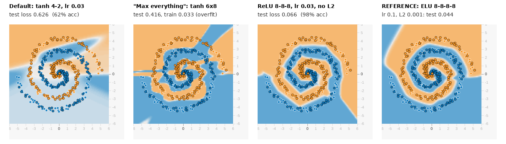

# Spiral Showdown: a 7-minute Deeper Playground challenge

Every student opens the same Deeper Playground link and gets the same data. In 7 minutes each student designs a
neural network. The lowest **Test loss at epoch 1,000** wins.

All numbers below come from Chrome, either on the live site or in a simulator that matches Chrome exactly.
Section 8 explains how they were checked.

---

## 1. Summary

| | |
|---|---|
| **Site** | https://deeperplayground.org (use **Chrome**) |
| **Data** | Spiral, noise 25, 50% training data, seed 0.12345. Hidden in the link, so it is the same for everyone. |
| **Inputs** | X₁ and X₂ only. The extra features are removed from the page by the link. |
| **Students may change** | Number of hidden layers (1–6) and neurons per layer (1–8), activation, learning rate, regularization (L1/L2) and its rate, batch size |
| **Score** | **Test loss** shown on screen at **epoch 1,000**. Lower wins. |
| **Reference network** | **ELU, 4 hidden layers of 8 (8-8-8-8), learning rate 0.1, L2 regularization 0.001, batch size 10**. Test loss **0.044** on the live site, 98% test accuracy. |
| **Best single score found** | **0.034**: ELU 8-8-6-4, learning rate 0.1, batch 5, L2 0.001. Verified live, but this start was lucky. |
| **Untouched starting network** | 0.626 (62% accuracy). A loss of 0.693 means the network knows nothing (coin flip). |

### Official link (give this to students)

```
https://deeperplayground.org/#activation=tanh&regularization=L2&batchSize=10&dataset=spiral&regDataset=reg-plane&learningRate=0.03&regularizationRate=0&noise=25&networkShape=4,2&seed=0.12345&showTestData=false&discretize=false&percTrainData=50&x=true&y=true&xTimesY=false&xSquared=false&ySquared=false&cosX=false&sinX=false&cosY=false&sinY=false&collectStats=false&problem=classification&initZero=false&hideText=true&animationSpeed=100&layerwiseGradientNormalization=0&learningRateAutotuning=-1&preventLossIncreases=false&dropout=0&momentum=0&dataset_hide=true&noise_hide=true&problem_hide=true&dropout_hide=true&animationSpeed_hide=true&momentum_hide=true&layerwise_hide=true&learningRateAutotuning_hide=true&preventLossIncreases_hide=true&xSquared_hide=true&ySquared_hide=true&xTimesY_hide=true&sinX_hide=true&sinY_hide=true
```

Tip: put it behind a short link or QR code. The link opens a plain tanh 4-2 network. It hides the dataset, noise,
problem type, dropout, animation speed, momentum, the three optimizer extras and the 5 engineered features.

### Reference network link (show it after the game)

```
https://deeperplayground.org/#activation=elu&regularization=L2&batchSize=10&dataset=spiral&regDataset=reg-plane&learningRate=0.1&regularizationRate=0.001&noise=25&networkShape=8,8,8,8&seed=0.12345&showTestData=false&discretize=false&percTrainData=50&x=true&y=true&xTimesY=false&xSquared=false&ySquared=false&cosX=false&sinX=false&cosY=false&sinY=false&collectStats=false&problem=classification&initZero=false&hideText=true&animationSpeed=100&layerwiseGradientNormalization=0&learningRateAutotuning=-1&preventLossIncreases=false&dropout=0&momentum=0&dataset_hide=true&noise_hide=true&problem_hide=true&dropout_hide=true&animationSpeed_hide=true&momentum_hide=true&layerwise_hide=true&learningRateAutotuning_hide=true&preventLossIncreases_hide=true&xSquared_hide=true&ySquared_hide=true&xTimesY_hide=true&sinX_hide=true&sinY_hide=true
```

To get the record network instead, change `networkShape=8,8,8,8` to `8,8,6,4` and `batchSize=10` to `5`.



*Live site, epoch 1,000, test points shown. Left to right: the untouched start; "max everything" (tanh 6×8) with
training loss 0.033 but test loss 0.416 (it memorised the training points); ReLU 8-8-8 without regularization;
the reference network, whose spiral is smooth and even.*

---

## 2. Candidate challenges we considered

We scanned 5 datasets × 3 noise levels × 7 typical networks (105 runs, 2,000 epochs each). Losses are test log loss.

| Candidate | Settings | Beginner result | Good result | Verdict |
|---|---|---|---|---|
| **A. Spiral Showdown** | spiral, noise 25, X₁ X₂ only, score at epoch 1,000 | default 0.626; 1 layer 0.52–0.66; sigmoid or linear about 0.68 | 0.04–0.05 | **Chosen.** Big gap, and each step up teaches one idea from the lecture. The top is reachable in under 1 minute of training. |
| B. Snowflake (Deeper only) | snowflake, noise 10, X₁ X₂ | default 0.538 | best of 7 nets 0.275 at epoch 1,000 (0.14 needs 2,000 epochs) | Too hard for 7 minutes, and results jump a lot with the starting weights, so luck decides. |
| C. Heart (Deeper only) | heart, noise 30, X₁ X₂ | default 0.307 | many nets 0.02–0.05 | Too easy, too many ties at the top. Good as a 2-minute warm-up. |
| (Moons) | any noise | 0.000 | 0.000 | Useless, everything solves it. |

**Optional second rounds** (same link and rules, change only what is stated):
* **Feature round** (shows engineered vs learned features). Remove the five `..._hide=true` feature locks, allow all features,
  and score at **epoch 300**. The best we found was 1 hidden layer of 8 ELU neurons with all 7 features, learning rate 0.1,
  L2 0.001: about 0.046 at epoch 300 (average of 3 starts). Without features, nets need 3–4 layers and more epochs.
  With features the end result still bottoms out near 0.04, because the noise sets the floor.
* **Budget round** (a design puzzle): at most 16 hidden neurons in total. The best we found was about 0.05–0.06
  (for example Swish 8-8, learning rate 0.1, batch 5, L2 0.003, average 0.060 over 6 starts).

---

## 3. Student rules (read these out or project them)

1. Open the link in **Chrome**. Keep the tab in front, because training **pauses when the tab is hidden**.
2. You may change the hidden layers (+/–), the neurons per layer (+/–), **Activation**, **Learning rate**,
   **Regularization** and **Regularization rate**, and **Batch size**. The inputs are X₁ and X₂ only.
3. **Never press REGENERATE and never move the "Ratio of training to test data" slider.** Both create new data.
   Your link then shows a different `seed`, and you are disqualified.
4. **Scoring run:** press **F5** (reload), then **Play**, then **Pause** just after the epoch counter passes **1,000**
   (by 1,050 at the latest). Your score is the **Test loss** on screen. Lower is better.
   F5 matters: after you change the network, its starting weights depend on what you did before. A fresh load
   always starts the same way, so anyone can replay your link and get your exact number.
5. Send the coach **your Test loss and the address-bar link** (it saves your whole design).
6. Don't change anything during the scoring run. The coach replays the top links at exactly epoch 1,000 in Chrome,
   and the replay is final.

**Timeline:** 0:00 open the link · 0:00–7:00 experiment (one run of 1,000 epochs takes about 17–60 s) ·
**3:00 hints 1–2** · **5:00 hint 3** · 7:00 stop, submit link + score · then reveal the reference.

---

## 4. Hints for the coach to read out

* **Minute 3, hint 1 (shape and activation):** "Straight lines can't wrap around a spiral. You need **3–4 hidden
  layers** and an activation from the **ReLU family** (ReLU, Leaky ReLU, **ELU**, Swish). Sigmoid and Linear won't make it."
* **Minute 3, hint 2 (learning rate):** "You only get 1,000 epochs. **0.03 is slow, 1 or 3 wrecks the network.
  Try 0.1.** If the loss sits at 0.69, the network has learned nothing. Make it smaller."
* **Minute 5, hint 3 (overfitting):** "Is your **training** loss tiny but your **test** loss much bigger, or does the loss
  curve have spikes? The network is too sure of itself. Add a pinch of **L2 regularization: 0.001** (0.03 is far too much).
  If you're already there, try **ELU** or **batch size 5**."

---

## 5. The reference network and its numbers

**ELU · 8-8-8-8 · learning rate 0.1 · L2 0.001 · batch 10** (starting from the default link it changes 4 controls:
activation, layers/neurons, learning rate, regularization rate)

| Measurement | Value |
|---|---|
| Test loss at epoch 1,000, **live site** (Play, auto-paused at exactly 1,000) | **0.044** (training loss 0.030) |
| Test accuracy (bookmarklet / exact) | 98.0% / 98.0% (5 of 250 test points wrong) |
| 12 different random starts, Chrome-exact | mean **0.043**, worst **0.052**, best 0.035 |
| 12 more starts in the Node simulator | mean 0.044, worst 0.066 |
| Time to epoch 1,000 (headless Chromium, software rendering) | 37 s (27 epochs/s); a normal laptop is probably faster |

It is the most reliable network we found. Across 24 random starts its test loss always ended between 0.035 and 0.066.
Other networks have lucky single scores, but on an unlucky start they can blow up to 0.2–0.5.

### Leaderboard: top 12 (Chrome-exact, 12 starting points each)

"Official link" is the score a student gets with the official seed. The mean and worst columns show how reliable the recipe is.

| # | Activation | Hidden layers | LR | Batch | Regularization | Official link | Mean of 12 | Worst of 12 |
|---|---|---|---|---|---|---|---|---|
| 1 | ELU | 8-8-8-8 | 0.1 | 5 | L2 0.001 | 0.038 | 0.042 | 0.082 |
| 2 | **ELU (reference)** | **8-8-8-8** | **0.1** | **10** | **L2 0.001** | **0.044** | **0.043** | **0.052** |
| 3 | ELU | 7-7-7 | 0.1 | 5 | L2 0.001 | 0.041 | 0.046 | 0.057 |
| 4 | ELU | 8-8-4 | 0.1 | 10 | L2 0.001 | 0.044 | 0.047 | 0.058 |
| 5 | Swish | 8-8-8 | 0.1 | 10 | L2 0.003 | 0.048 | 0.048 | 0.058 |
| 6 | Swish | 7-7-7 | 0.1 | 10 | L2 0.001 | 0.063 | 0.049 | 0.063 |
| 7 | Swish | 8-8-8 | 0.03 | 5 | L2 0.001 | 0.048 | 0.050 | 0.074 |
| 8 | Swish | 8-8-8 | 0.03 | 5 | none | 0.051 | 0.051 | 0.068 |
| 9 | Leaky ReLU | 8-8-8 | 0.1 | 10 | L2 0.003 | 0.093 | 0.051 | 0.093 |
| 10 | ELU | 8-8-4 | 0.03 | 5 | L2 0.001 | 0.049 | 0.051 | 0.061 |
| 11 | ReLU | 8-8-8 | 0.1 | 10 | L2 0.003 | 0.048 | 0.051 | 0.074 |
| 12 | Swish | 8-8-8 | 0.1 | 10 | L2 0.001 | 0.064 | 0.052 | 0.094 |
| – | ELU (record) | 8-8-6-4 | 0.1 | 5 | L2 0.001 | **0.034** | 0.062 | 0.203 |
| – | ReLU | 8-8-8-8 | 0.1 | 10 | L2 0.001 | 0.041 | 0.065 | 0.230 |

**Verified on the live site at epoch 1,000:** reference 0.044 · record 0.034 · ELU 7-7-7 0.041 · ReLU 8-8-8-8 0.041 ·
Swish 8-8-8 0.048 · ReLU 8-8-8 (L2 0.003) 0.048. Each matched the Chrome-exact simulator bit for bit.

### What typical beginners get (official link, epoch 1,000)

| What they try | Official test loss | Test acc. | Train loss | Mean of 12 starts |
|---|---|---|---|---|
| Untouched default: tanh 4-2, lr 0.03 | **0.626** (live) | 62% | 0.532 | 0.654 |
| Sigmoid 4-2 | 0.677 | 57% | 0.654 | 0.677 |
| Linear 8-8-8 | 0.672 | 56% | 0.654 | 0.672 |
| One wide layer: ReLU 8 / tanh 8 | 0.680 / 0.471 | 63% / 79% | 0.649 / 0.407 | 0.664 / 0.521 |
| Tanh 8-8, lr 0.03 | **0.360** (live) | 88% | 0.156 | 0.271 |
| ReLU 8-8, lr 0.03 | 0.315 | 92% | 0.074 | 0.220 |
| "Max everything": tanh 6×8, lr 0.03 | **0.416** (live) | 92% | **0.033** | 0.325 |
| ReLU 6×8, lr 0.03 | 0.112 | 96% | 0.024 | 0.128 |
| ReLU 8-8-8, lr 0.03, no regularization | **0.066** (live) | 98% | 0.035 | 0.090 |
| ReLU 8-8-8, lr 0.1, no regularization | 0.191 | 90% | 0.174 | 0.280 |
| ReLU 8-8-8, lr 0.003 (too slow) | 0.623 | 68% | 0.506 | 0.629 |
| ReLU 8-8-8, lr 0.3 | 0.639 | 52% | 0.647 | 0.548 |
| ReLU 8-8-8, lr 1 / ReLU 6×8, lr 3 | 0.755 / **0.694** (live) | 52% / 48% | 0.787 / 0.693 | 0.750 / 0.694 |
| ReLU 8-8-8, lr 0.1, batch 1 | 0.717 | 52% | 0.738 | 0.697 |
| ReLU 8-8-8, lr 0.1, batch 30, L2 0.001 | 0.071 | 98% | 0.044 | 0.089 |
| ReLU 8-8-8, lr 0.1, L2 0.01 / 0.03 (too much) | 0.065 / 0.675 | 98% / 56% | 0.059 / 0.659 | 0.091 / 0.674 |
| ReLU 8-8-8, lr 0.1, L1 0.001 / L1 0.01 | 0.159 / 0.674 | 92% / 58% | 0.100 / 0.659 | 0.276 / 0.673 |

---

## 6. Why the reference wins (plain language, for students)

**What the score means.** For each test point the network says how sure it is that the point is blue. *Log loss*
punishes being sure and wrong much more than being unsure. Saying "50/50" about every point costs 0.693, which is
why a network that learned nothing sits at 0.69. Saying "99.99% blue" about an orange point costs about 9 points.

**1. You need bends, not lines (activation).** A *Linear* network, however big, can only draw one straight line:
0.672, a coin flip. Each ReLU-type neuron is a straight line with a fold in it. Adding these up lets the network
draw corners and curves.

**2. Depth beats width (layers vs neurons).** One layer of 8 neurons gives 8 straight cuts, which can't trace two
arms that wind around each other (0.52–0.66). Every extra layer folds the picture again: layer 1 draws lines,
layer 2 combines them into corners and patches, and layers 3–4 bend those into curved bands. The neuron pictures in
the screenshot show this, getting more curved from left to right. 8-8 gets halfway (about 0.22–0.27 on average),
3–4 layers get to 0.04. Six layers is not better: it trains more slowly per second, and it has room to memorise
the noise.

**3. Why ELU and not tanh or sigmoid (the learning signal).** Tanh and sigmoid flatten out for big inputs. When the
network learns, the error signal is passed back through every layer. A flat curve passes on almost nothing, and
sigmoid passes on at most a quarter of the signal at each layer. In a deep tanh or sigmoid net the first layers
hardly learn, so sigmoid 6×8 stays stuck at 0.693. ReLU passes the signal through untouched (for positive inputs).
**ELU is a ReLU whose negative side curves gently down to −1 instead of being flat at 0.** That gives two advantages:
1. Its neurons can't "die". A ReLU neuron that only ever gets negative inputs outputs 0 forever and stops learning.
   High learning rates cause this a lot.
2. Its outputs are centred near zero, which makes the next layer's job easier.

Same 8-8-8-8 network: ELU averages 0.043, ReLU 0.065 with a worst start of 0.23.

**4. Learning rate 0.1 (step size).** You only get 1,000 epochs. Too small (0.003) and the network barely moves
(0.63). 0.03 works, but it is often not finished at epoch 1,000. Too big (0.3, 1, 3) and every step overshoots.
ReLU neurons die and the loss gets stuck at 0.69–0.76. 0.1 is the largest step that stays stable, especially with
a little L2 (see 5).

**5. A pinch of L2 (overfitting and over-confidence).** Noise mixes the two arms up right in the **centre** of the
spiral. All 5 test points the reference gets wrong are within 0.25 of the centre, and **those 5 points make up
80% of its test loss**. No network can get them right, so the winner is the network that is *humble* about them.
Without regularization the weights keep growing, so the network becomes extremely sure everywhere, including on the
hopeless points:
* "Max everything" tanh 6×8: training loss 0.033 but test loss 0.416. It memorised the training points (see the
  jagged picture).
* With learning rate 0.1, growing weights also cause blow-ups: in 8 of 12 starts, ReLU 8-8-8 without L2 ended much
  worse than its own best moment.

L2 = 0.001 gently pulls every weight towards 0 at each step. That keeps the boundary smooth and slightly unsure in
the centre, and it keeps training stable. Too much L2 (0.03) pulls harder than the data can push back, so the
network can't bend at all (0.674). L1 0.01 does the same by cutting links to exactly zero.

**6. Batch size 5–10 (how many points per update).** Batch 1 with learning rate 0.1 is too jumpy (0.70). Batch 30
makes only about 8 updates per epoch, so it is slower to get anywhere (about 0.09). 5–10 is the sweet spot. Batch 5
gives the best single scores (0.034, 0.038), with slightly more luck involved.

**7. Why nobody reaches 0.** About 2% of the test points sit on the wrong arm because of the noise. Every top network
reaches the same 98% accuracy, so the *loss* (how humble the network is about those points) decides the winner.
We searched about 1,000 configurations in the simulator and re-ran 63 of them Chrome-exact. The lowest score on
the official link was 0.034–0.035. **Anything under 0.05 is excellent.**

---

## 7. Coach checklist and tools

**Before class**
* Open the official link in Chrome, press Play once, and check that it runs (deeperplayground.org is a hobby site from 2019).
* Optional: add `autopause_bookmarklet.txt` as a bookmark (make a bookmark and paste its whole text as the URL). Clicking
  it presses Play and **pauses exactly at epoch 1,000**, then shows the test loss. It was tested on the live site and
  stopped at 001,000 with 0.044 for the reference. Students can use it too.
* Optional: `accuracy_bookmarklet.txt` pops up an approximate test accuracy (±2%).

**Judging**
* Check each winning link has `seed=0.12345`, `noise=25`, `dataset=spiral`, `percTrainData=50` and no extra
  features switched on.
* **Re-run the top 3 in Chrome:** paste the link, press F5, click the auto-pause bookmark. The number shown is the
  official score.
* Or score everyone at once: put `name link` lines in a text file and run
  `NODE_PATH=$(npm root -g) node sim/score.js submissions.txt`. It replays each link for exactly 1,000 epochs in
  headless Chromium (matches Chrome bit for bit), checks the rules, and prints a ranked table with test accuracy.
  Example output:
  ```
  rank  name                 test loss  test acc  train loss  network
     1  Record                   0.034     98.0%       0.026  elu 8-8-6-4 lr 0.1 batch 5 L2 0.001
     2  Reference                0.044     98.0%       0.030  elu 8-8-8-8 lr 0.1 batch 10 L2 0.001
     3  TanhMax                  0.416     92.4%       0.033  tanh 8-8-8-8-8-8 lr 0.03 batch 10 L2 0
     4  Default                  0.626     62.0%       0.532  tanh 4-2 lr 0.03 batch 10 L2 0
     -  Regenerated          DISQUALIFIED: seed=0.39090 (must be 0.12345)
  ```

**Known pitfalls (all tested)**
* **Different browsers can give different scores.** Training here is sensitive: tiny rounding differences in the
  browser's maths grow over 1,000 epochs. Node.js and Chrome gave 0.051 vs 0.044 for the same reference link.
  Safari or Firefox may differ the same way, so **score in Chrome**. Differences of about 0.005 between top students
  are mostly luck; consider declaring a tie below that.
* **Pressing F5 is required.** If a network is built by clicking and run without reloading, its starting weights are
  different (tested: 0.675 vs 0.677 after 30 epochs). After F5 the live site matched the replay exactly.
* **Regenerate** changes the seed (tested: 0.12345 → 0.39090) and the link shows it. The ratio slider does the same
  (from the code).
* A hidden tab stops training. A slow laptop just takes longer, so the score does not depend on hardware.
* **Fallback if deeperplayground.org is down:** use playground.tensorflow.org with the same spiral link minus the
  Deeper-only keys (below). It has no ELU and uses a different loss (squared error), so the numbers are different.
  There the default scores 0.457 and **ReLU 8-8-8-8, learning rate 0.1, L2 0.001 scores 0.036** (Chrome-exact simulator, not
  checked on the live site; average 0.032 over 6 starts):
  `https://playground.tensorflow.org/#activation=tanh&batchSize=10&dataset=spiral&regDataset=reg-plane&learningRate=0.03&regularizationRate=0&noise=25&networkShape=4,2&seed=0.12345&showTestData=false&discretize=false&percTrainData=50&x=true&y=true&xTimesY=false&xSquared=false&ySquared=false&cosX=false&sinX=false&cosY=false&sinY=false&collectStats=false&problem=classification&initZero=false&hideText=true&dataset_hide=true&noise_hide=true&problem_hide=true&xSquared_hide=true&ySquared_hide=true&xTimesY_hide=true&sinX_hide=true&sinY_hide=true`

---

## 8. How this was tested

* **Simulator.** I ported Deeper Playground's training code to Node.js (`sim/deeper-sim.js`). The port covers log loss,
  the 8 activations, the 8 datasets, momentum, layerwise normalization, dropout and the per-epoch random-number draws.
  It was checked against the **live** deeperplayground.org on 7 configurations covering every new feature. Run inside
  Chromium, it matched the site **bit for bit at every checkpoint** (`sim/validation-deeper-log.txt`).
  Plain Node matched the 3 displayed decimals over the first 150 epochs.
* **Search.** About 7,300 training runs of 1,000 epochs covered 1,031 X₁/X₂ configurations on spiral noise 25. The
  stages were:
  1. A full grid of 8 activations × 11 shapes × 6 learning rates (also run at noise 20 and 30).
  2. 6 starts each for 216 promising configurations.
  3. Regularization and batch-size variants.
  4. 12 starts for the finalists, re-run in Chromium for Chrome-exact numbers.

  On top of that came 864 runs for the feature round and 330 runs on the original Playground for the fallback.
  Different starting weights came from a separate random stream (`weightSeed`). The official link uses the site's own
  start.
* **Live verification.** 11 networks (6 top, 5 beginner-style) were loaded on deeperplayground.org in headless Chromium
  and run with Play, auto-paused at exactly epoch 1,000. All 11 matched the Chrome-exact simulator bit for bit
  (`sim/verify-live.json`). A student-flow test built the reference by clicking the UI. The link kept all locks and the
  seed, and after F5 it matched the simulator (`sim/student-flow.js`). Screenshots are in `shots/`.

**Files** (all under `/tmp/claude-0/-home-user-solid-eureka/86c8d8ec-0fba-57b8-9249-8695458b91c0/scratchpad/playground/`):
`challenge.md` (this file) · `shots/compare_boundaries.png`, `shots/reference_page.png`, `shots/reference_boundary.png`,
`shots/beginner_*_page.png`, `shots/beginner_*_boundary.png`, `shots/record_elu8864_b5_*.png`, `shots/alt_*.png` ·
`autopause_bookmarklet.txt` (+ source `scripts/autopause_1000.js`) · `accuracy_bookmarklet.txt` ·
`sim/score.js`, `sim/challenge.js`, `sim/deeper-sim.js`, `sim/deeper-chromium-runner.js`,
`sim/validate-deeper.js`, `sim/verify-live.js`, `sim/student-flow.js`, `sim/test-autopause.js` ·
search data in `work/` (`s1…s7.jsonl` Node runs, `c1.jsonl` Chrome-exact runs, `scan.jsonl` dataset scan, `orig.jsonl` fallback).
